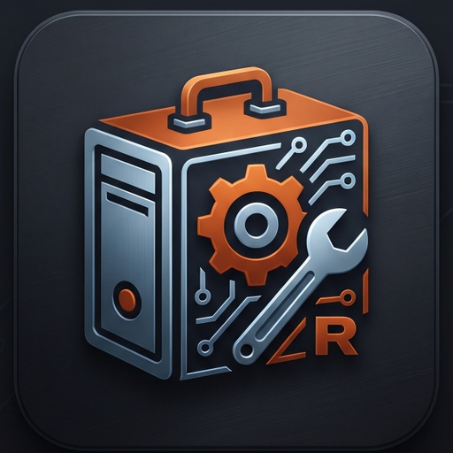
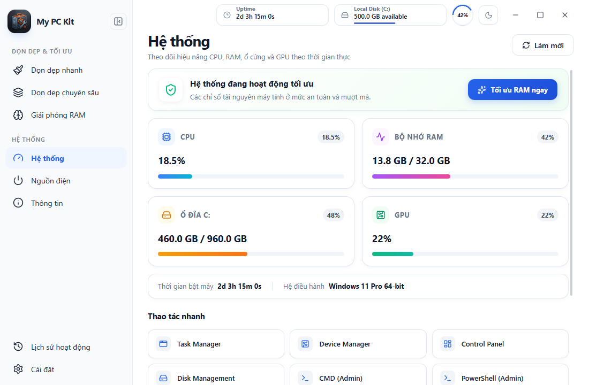
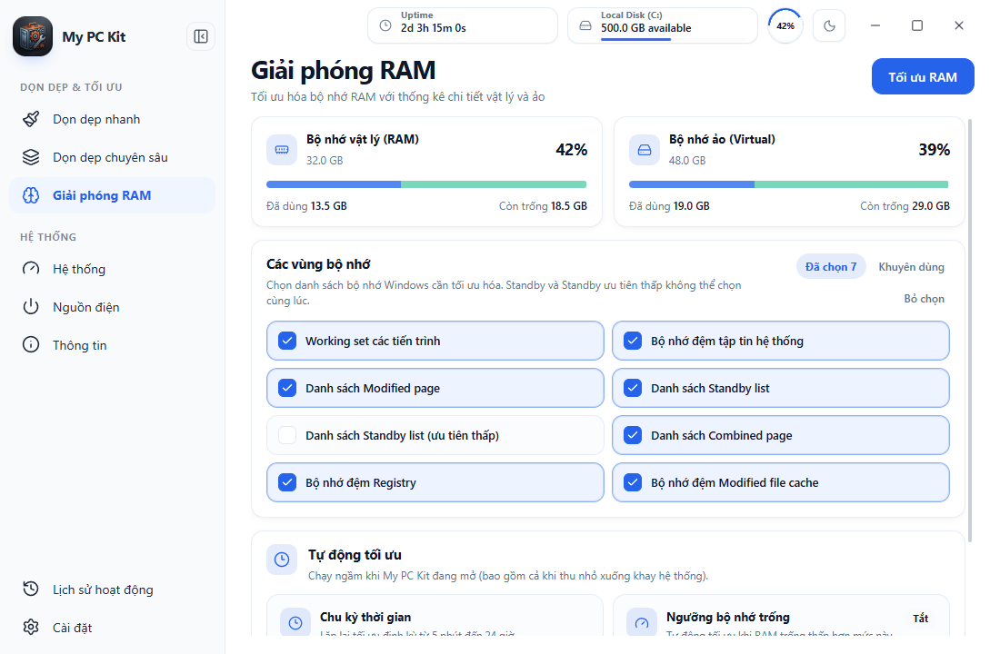
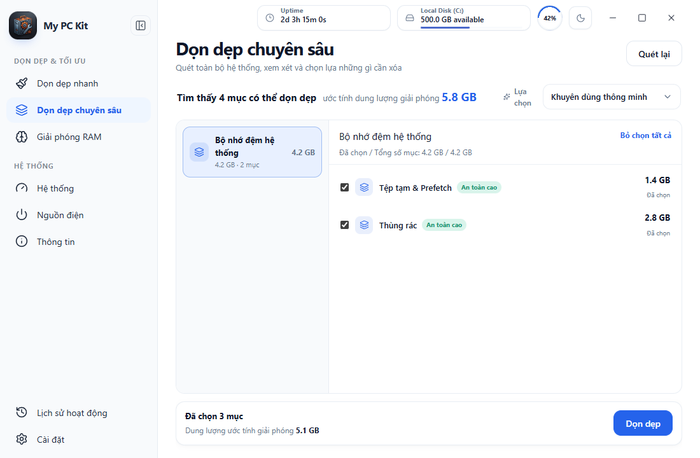
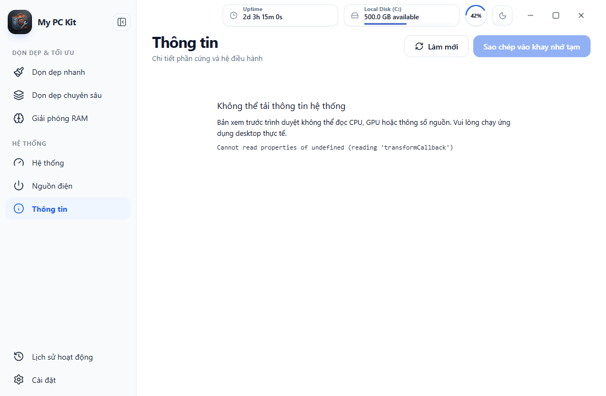

<div align="center">

# 🛠️ My PC Kit
### Bộ công cụ Tinh gọn & Quản trị Hệ thống Windows Thế hệ Mới

[](https://github.com/Duc-bug/My-pc-kit/releases/latest)
[](https://github.com/Duc-bug/My-pc-kit)
[](https://www.rust-lang.org/)
[](https://tauri.app/)
[](https://vuejs.org/)
[](LICENSE)

<br/>



<br/>
<br/>

<p align="center">
  <strong>My PC Kit</strong> là giải pháp quản trị, tối ưu phần cứng và dọn dẹp hệ thống chuyên sâu dành riêng cho Windows 10 & 11.<br/>
  Được phát triển với tiêu chuẩn <strong>Zero-Bloatware</strong>: Cực nhẹ (~15MB RAM), không tiến trình chạy ngầm vô bổ, giao diện sáng tinh khôi và tương tác native trực tiếp qua Win32 API.
</p>

<p align="center">
  <a href="#-t%E1%BA%A3i-v%E1%BB%81--c%C3%A0i-%C4%91%E1%BA%B7t-download">📥 <strong>Tải về bộ cài (.exe)</strong></a> •
  <a href="#-t%C3%ADnh-n%C4%83ng-ch%C3%ADnh">✨ <strong>Tính năng</strong></a> •
  <a href="#-h%C3%ACnh-%E1%BA%A3nh-giao-di%E1%BB%87n">🖼️ <strong>Giao diện</strong></a> •
  <a href="#-so-s%C3%A1nh-v%C6%B0%E1%BB%A3t-tr%E1%BB%99i">⚖️ <strong>So sánh</strong></a> •
  <a href="#-h%C6%B0%E1%BB%9Bng-d%E1%BA%ABn-ph%C3%A1t-tri%E1%BB%83n-developer-guide">💻 <strong>Dành cho Dev</strong></a>
</p>

</div>

---

## 💡 Triết lý thiết kế (Core Philosophy)

Hầu hết các phần mềm dọn dẹp và tối ưu hóa hệ thống hiện nay đều quá cồng kềnh, cài kèm quảng cáo hoặc sử dụng các lệnh script PowerShell giả lập không an toàn. **My PC Kit** được tạo ra để thay đổi điều đó:

- 🚀 **Siêu tốc & Tiết kiệm tài nguyên:** Viết bằng Rust thuần tương tác trực tiếp với Windows NT Kernel. Thời gian mở ứng dụng dưới 0.2 giây, dung lượng chiếm dụng chỉ bằng 1/10 các ứng dụng nền tảng Electron.
- 🛡️ **An toàn tuyệt đối:** Mọi thao tác dọn dẹp đều tuân thủ nguyên tắc *Skip-and-Continue* (tự động bỏ qua tệp tin đang được Windows sử dụng), không gây lỗi hệ điều hành hay hỏng Registry.
- 👁️ **Trung thực & Minh bạch:** Thống kê giải phóng RAM dựa trên API thật (`GetPerformanceInfo`, `SetSystemFileCacheSize`, `EmptyWorkingSet`), báo cáo chính xác dung lượng thực tế.
- 🎨 **Thiết kế công thái học:** Tông màu sáng chủ đạo thanh lịch, tối giản, hỗ trợ đa ngôn ngữ hoàn chỉnh (Tiếng Việt & English).

---

## ✨ Tính năng chính

### 1. ⚡ Tối ưu RAM tức thì (Memory Engine)
* **Thu hồi Standby List & Working Set:** Giải phóng các phân vùng bộ nhớ đệm dư thừa mà Windows chưa kịp trả lại.
* **Tự động tối ưu thông minh:** Thiết lập chu kỳ tự động dọn RAM hoặc kích hoạt khi lượng RAM khả dụng xuống dưới mức giới hạn định trước.
* **Tối ưu 1-click từ Khay hệ thống:** Chuột phải vào biểu tượng khay màn hình để tối ưu ngay mà không cần mở cửa sổ ứng dụng.

### 2. 🧹 Dọn dẹp chuyên sâu đa phân hệ (Deep Cleanup)
* **Dọn rác hệ thống:** Làm sạch tệp tạm `%TEMP%`, bộ đệm tải xuống Windows Update, DirectX Shader Cache và Prefetch.
* **Cache ứng dụng phổ biến:** Tự động phát hiện và dọn dẹp bộ nhớ đệm của Telegram, Discord, Steam, Spotify, VS Code, JetBrains,...
* **Trình duyệt Web:** Dọn sạch cache thừa của Chrome, Edge, Brave, Firefox, Opera, Cốc Cốc mà không làm mất mật khẩu hay lịch sử duyệt web quan trọng.
* **Nhà phát triển (Developer Caches):** Xóa cache package cồng kềnh của npm, pnpm, yarn, cargo, pip, go build cache.

### 3. 📊 Giám sát phần cứng thời gian thực (Hardware Telemetry)
* **Màn hình tổng quan:** Theo dõi trực tiếp tần số xung nhịp CPU, % tải GPU, dung lượng RAM và tình trạng ổ đĩa C.
* **Đánh giá sức khỏe hệ thống:** Tự động phân tích các chỉ số phần cứng và gợi ý thao tác xử lý khi máy tính bị nghẽn tài nguyên.
* **Báo cáo phần cứng chi tiết:** Xuất thông tin toàn diện về Mainboard, BIOS, CPU Cores/Threads, loại RAM (DDR4/DDR5/Bus speed), màn hình và chuẩn pin/nguồn.

### 4. 🧰 Thao tác nhanh & Quản trị nguồn (Quick Toolkit)
* **15 phím tắt quản trị:** Mở nhanh Task Manager, Device Manager, Command Prompt (Admin), PowerShell (Admin), Registry Editor, Disk Management chỉ bằng 1 cú nhấp.
* **Hẹn giờ tắt máy (Power Scheduler):** Đặt lịch tắt máy, khởi động lại hoặc ngủ với đồng hồ đếm ngược trực quan và nút hủy lệnh an toàn (`shutdown /a`).

---

## 🖼️ Hình ảnh giao diện

<div align="center">

### Giám sát Hệ thống & Thao tác nhanh


### Bộ công cụ Tối ưu RAM & Bộ nhớ Win32


### Dọn dẹp Cache Chuyên sâu có Kiểm soát


### Báo cáo Thông tin Phần cứng Chi tiết


</div>

---

## ⚖️ So sánh vượt trội

| Tiêu chí | Phần mềm truyền thống (CCleaner / ASC) | My PC Kit 🛠️ |
| :--- | :---: | :---: |
| **Kích thước bộ cài** | 60 MB – 120 MB | **Chỉ ~4.5 MB** |
| **RAM tiêu thụ khi chạy** | 150 MB – 300 MB (Electron / Chromium) | **~15 MB – 25 MB (Rust + WebView2)** |
| **Quảng cáo & Popup** | Thường xuyên gợi ý mua bản quyền | **100% Miễn phí & Mã nguồn mở** |
| **Tối ưu RAM** | Lệnh ảo hoặc ép ghi pagefile gây đơ máy | **Gọi trực tiếp Windows NT Native API** |
| **Bảo mật & Mã nguồn** | Mã nguồn đóng, thu thập dữ liệu ẩn | **Mã nguồn mở minh bạch (MIT License)** |
| **Tùy biến giao diện** | Tối mịt, phức tạp | **Giao diện sáng hiện đại, tối giản, thanh lịch** |

---

## 📥 Tải về & Cài đặt (Download)

Bạn có thể tải ngay phiên bản chính thức mới nhất tại trang **[Releases](https://github.com/Duc-bug/My-pc-kit/releases/latest)**:

| Loại tệp | Mô tả | Tải về |
| :--- | :--- | :---: |
| **`My.PC.Kit.v1.0.1.Setup.exe`** | Bản cài đặt chuẩn NSIS (Hỗ trợ Start Menu, tự động tạo shortcut) | [**Tải Setup (.exe)**](https://github.com/Duc-bug/My-pc-kit/releases/latest) |
| **`MyPCKit.exe`** | Bản Portable chạy ngay không cần cài đặt | [**Tải Portable (.exe)**](https://github.com/Duc-bug/My-pc-kit/releases/latest) |

> [!NOTE]
> Bộ cài đặt hoạt động theo chế độ `currentUser` (lưu tại `%LOCALAPPDATA%\My PC Kit\`), không đòi hỏi quyền Administrator khi cài đặt và có thể gỡ bỏ hoàn toàn sạch sẽ bất cứ lúc nào.

---

## 💻 Hướng dẫn phát triển (Developer Guide)

Nếu bạn muốn đóng góp hoặc tự build ứng dụng từ mã nguồn:

### Yêu cầu cài đặt
* [Node.js](https://nodejs.org/) v18+ & [pnpm](https://pnpm.io/)
* [Rust toolchain](https://rustup.rs/) (stable-x86_64-pc-windows-msvc)
* Visual Studio C++ Build Tools

### Các bước biên dịch

```bash
# 1. Clone mã nguồn
git clone https://github.com/Duc-bug/My-pc-kit.git
cd My-pc-kit

# 2. Cài đặt dependencies
pnpm install

# 3. Chạy giao diện ở môi trường dev (Hot-reload)
pnpm dev

# 4. Chạy toàn bộ ứng dụng desktop với Tauri
pnpm tauri:dev

# 5. Đóng gói bộ cài đặt Release (.exe)
pnpm tauri:build
```

---

## 👥 Đội ngũ & Đóng góp (Contributors)

Dự án được bảo trì và phát triển chính bởi:
* **Duc Nguyen** ([@Duc-bug](https://github.com/Duc-bug)) — *Tác giả & Kiến trúc sư chính*
* **AntiGravity** ([@AntiGravity](https://github.com/AntiGravity)) — *Cộng tác viên AI (Tối ưu hóa hiệu năng, refactoring & CI/CD)*

Mọi ý kiến đóng góp, báo lỗi hoặc yêu cầu tính năng mới đều được hoan nghênh tại mục [GitHub Issues](https://github.com/Duc-bug/My-pc-kit/issues).

---

## 📄 Bản quyền (License)

Dự án được phát hành dưới giấy phép mã nguồn mở **[MIT License](LICENSE)**.
Tự do sử dụng, chỉnh sửa và chia sẻ vì một cộng đồng người dùng Windows sạch và mượt hơn!
